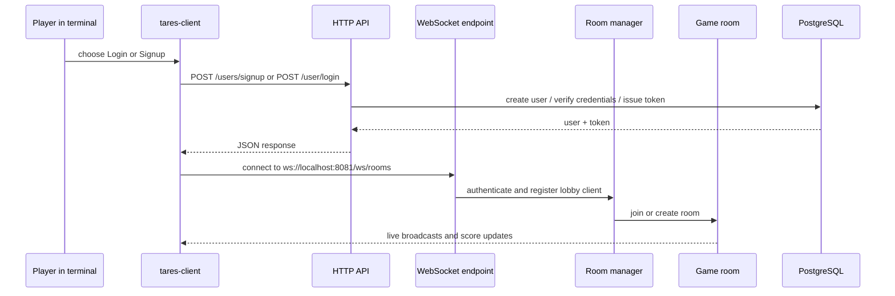
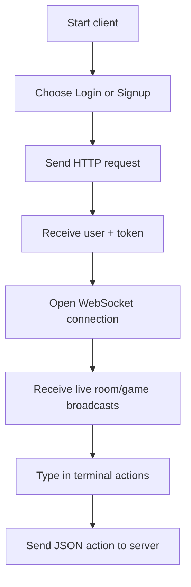

# TARES GAME 

### What Is It All About?
It's all about the fun of wordscrable game, but this time delivered over websocket with real-time capabilities so you can challenge your friends or even complete strangers to a 'fight'. 
Tares delivers the multiplayer capability of word scrable with intuitive UI that aims to help you relax while you have fun playing wordscrable with your friends

- Tares help you polish your spelling and critical thinking & problem solving abilities while you enjoy and beat/be beaten to a fight.

## Technical Diagrams 
The App combines two current microservices, handling user stats, websocket connections and room managements as well as live updates broadcasting. This feature combine with intuitive UI elements help you focus on the game while the engine does the heavy light. 

Look under the hood: 
```mermaid
flowchart TD
	CLIENT[[Web Browser]] <--> |Communicates| NGINX[Reverse Proxy]
  NGINX <--> Backend 
  
	subgraph Backend
	   direction LR
	  subgraph  Game_Microservice
		  direction LR 
      User_APIs[(REST API microservice)]
      DB1[(User databased)]
      DB1 --> User_APIs
		end

		subgraph  Game_Microservice  
		  direction LR
      Game_Engine[(Game engine + Websocket)]
      DB2[(User databased)]
      DB2 --> Game_Engine
		end

		subgraph  Merch_Microservice  
		  direction LR
      Merch[(Coming Soon)]
      DB3[(User databased)]
      DB3 --> Merch
		end
		
	end
	
  NGINX <-->|HTTP| User_APIs
  NGINX <-->|WebSocket| Game_Engine
  Game_Microservice <--> |gRPC| User_Microservice
  User_Microservice <--> |gRPC| Merch_Microservice

  classDef client fill:#eaf7ea,stroke:#3a7d44,stroke-width:1.5px
  classDef gateway fill:#f3e8fd,stroke:#7b4fa0,stroke-width:1.5px
  classDef service fill:#e8f0fe,stroke:#4a6fa5,stroke-width:1.5px
  classDef database fill:#fef6e4,stroke:#b08500,stroke-width:1.5px

  class CLIENT client 
  class NGINX gateway
  class User_APIs, Game_Engine service
  class DB1,DB2 database
```

## Demo 


## User install and Testing Guide 


## Contributing 


## Known Issues 


## Buy Me a Coffee


## How It Works



## Quick Start

### Requirements

- Go 1.26.3 or compatible
- PostgreSQL running locally
- A database named `tares_db`

### Database Connection

The server currently opens PostgreSQL with this connection string:

```text
host=localhost user=logic dbname=tares_db port=5433 password=logicgate sslmode=disable
```

Adjust your local database to match that configuration, or update the server code before running.

### Run The Server

```bash
go run ./server
```

The server listens on port `8081` by default and applies database migrations on startup.

### Run The Client

```bash
go run ./client
```

The client will prompt you to:

1. Login
2. Signup
3. Exit


After authentication, it opens a WebSocket connection to:

```text
ws://localhost:8081/ws/rooms
```

## Terminal Flow



## Supported Client Actions

The client currently sends these actions after the socket is open:

- `SEND_WORD`
- `PAUSE_GAME`
- `RESUME_GAME`
- `STOP_GAME`

## Project Layout

```text
client/
	main.go                 terminal entrypoint
	helpers/                auth and HTTP helper functions

server/
	main.go                 server entrypoint
	internals/api/          HTTP handlers
	internals/middleware/   request auth middleware
	internals/route/        route registration
	internals/ws/           room manager and websocket clients
	internals/store/        database access
	migrations/             goose migrations
	dictionary/             word lists
```