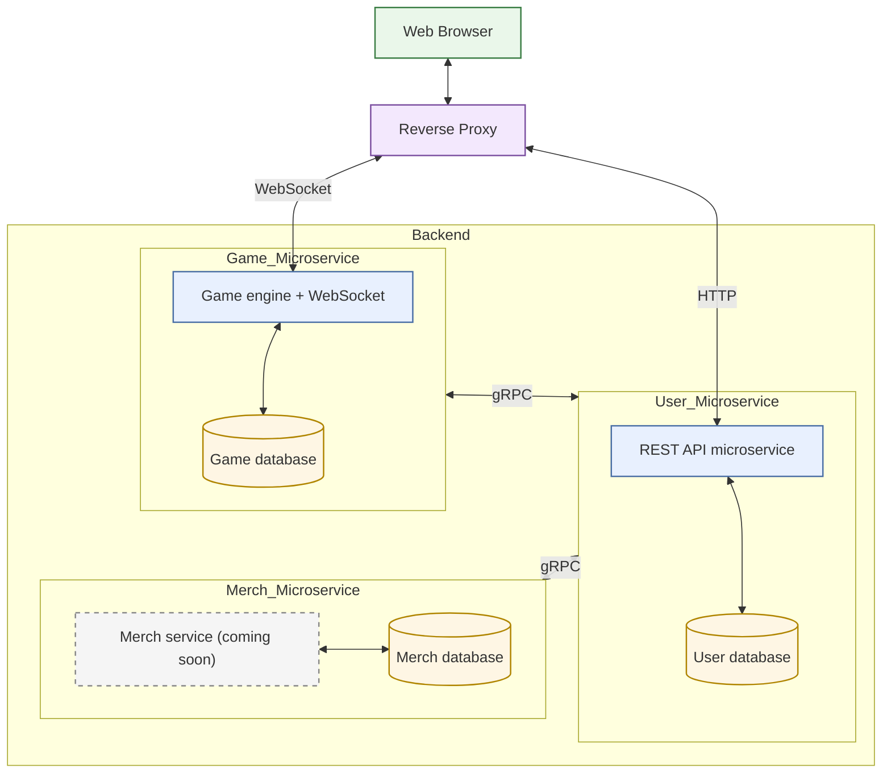
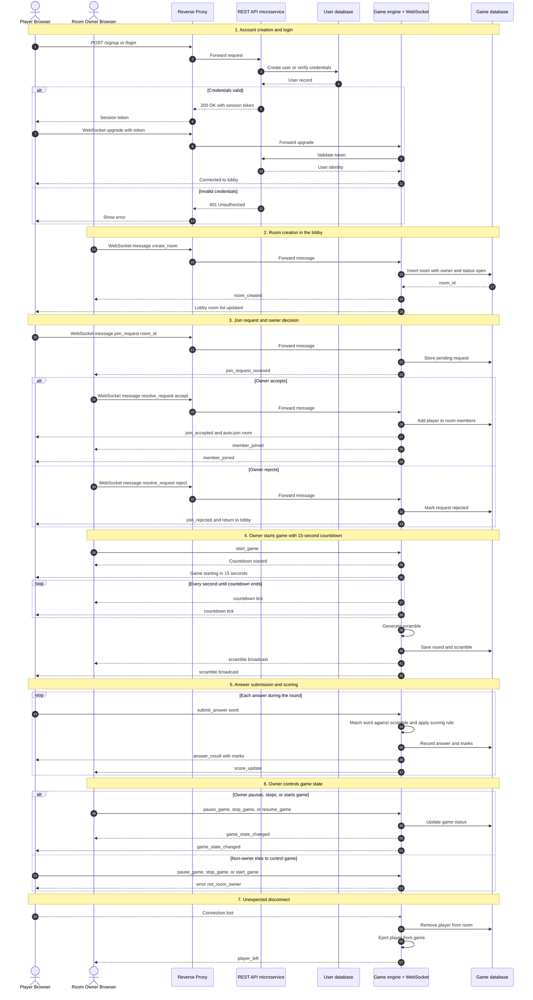

# TARES GAME 

### What Is It All About?
It's all about the fun of wordscrable game, but this time delivered over websocket with real-time capabilities so you can challenge your friends or even complete strangers to a 'fight'. 
Tares delivers the multiplayer capability of word scrable with intuitive UI that aims to help you relax while you have fun playing wordscrable with your friends

- Tares help you polish your spelling and critical thinking & problem solving abilities while you enjoy and beat/be beaten to a fight.

## Technical Diagrams 
The App combines two current microservices, handling user stats, websocket connections and room managements as well as live updates broadcasting. This feature combine with intuitive UI elements help you focus on the game while the engine does the heavy light. 



### The sequence of user Experience: 
- User create account/login via the web client
- User lands in a game lobby where they can create their own rooms online and make them available to others
- Or Request to join and available online room. 
- Once room join request is resolved either 'accpeted' or 'rejected' user may join the room automatically or be kicked out. 
- When user gets in the game room, they're make aware when room owner starts game and receives a 15 seconds counddown time, after which the game starts
- Scramble is generate by server and sent to all connected clients in a room , and each players answers are match with words using a determined criteria to award marks. 
- When user leaves room unexpectedly, they're ejected from game.
- Only Room owner can stop/start/pause game. 



## Demo 


## User install and Testing Guide 


## Contributing 


## Known Issues 


## Buy Me a Coffee


## Quick Start

### Requirements

- Go 1.26.3 or compatible
- PostgreSQL running locally
- A database named `tares_db`

### Database Connection

The server currently opens PostgreSQL with this connection string:

```text
host=localhost user=logic dbname=tares_db port=5433 password=logicgate sslmode=disable
```

Adjust your local database to match that configuration, or update the server code before running.

### Run The Server
