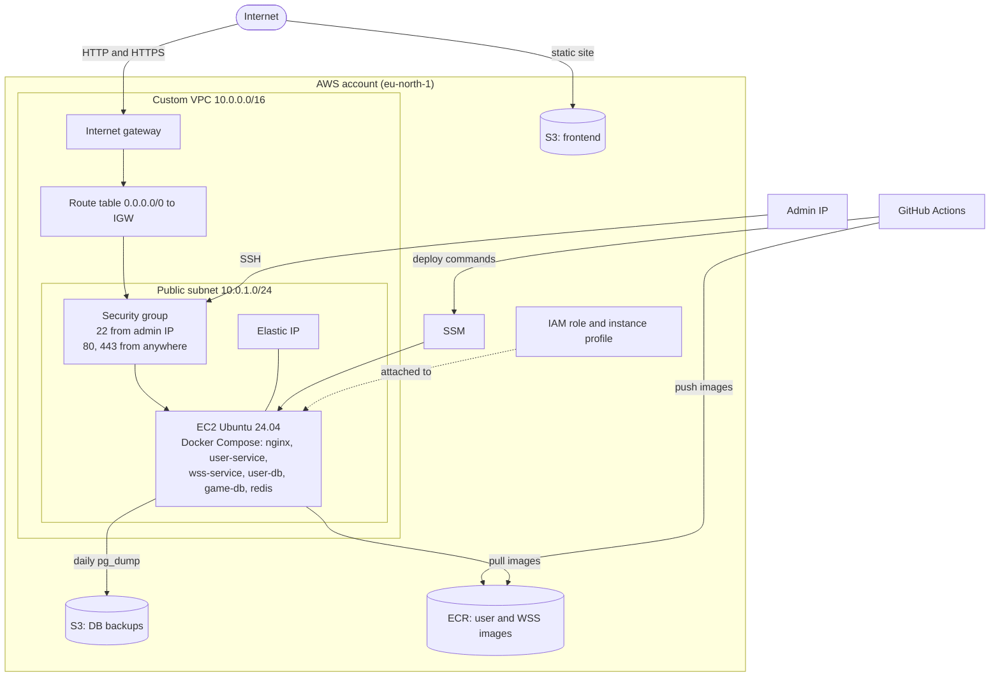

# AWS Infrustructure Provision with Terraform

This infrustructure provisioning is for the deployment of the Tares Game. Frontend and the backend components are created separately. 

A general overview of components and interactions are shown below



## Provision

```sh
cp infra/terraform.tfvars.example infra/terraform.tfvars
# Set admin_cidr, public_key_path, and a unique frontend_bucket_name.
aws configure
terraform -chdir=infra init
terraform -chdir=infra apply
```

Terraform uses the normal AWS credential chain (`AWS_PROFILE` or environment
credentials). It does not accept AWS credentials as Terraform variables.

## GitHub values

Set `API_BASE_URL` as a repository variable so reusable CI can build the
frontend. Set the remaining values in the `production` environment:

- Variables: `REGION`, `FRONTEND_BUCKET`, `INSTANCE_ID`, `FRONTEND_URL`,
  `API_BASE_URL`, and `GHCR_USERNAME`
- Secrets: `AWS_ACCESS_KEY_ID`, `AWS_SECRET_ACCESS_KEY`, `GHCR_READ_TOKEN`,
  `USER_DB_USER`, `USER_DB_PASSWORD`, `USER_DB_NAME`, `GAME_DB_USER`,
  `GAME_DB_PASSWORD`, `GAME_DB_NAME`, and `AUTH_SECRET`

For the current domainless setup, use the Terraform outputs:

```text
API_BASE_URL = http://<api_ip>/api/v1
FRONTEND_URL = <frontend_url>
```

The deployment is HTTP-only until a domain and TLS termination are added.


api_ip = "51.20.207.249"
frontend_bucket = "tares-frontend-prod-12345"
frontend_url = "http://tares-frontend-prod-12345.s3-website.eu-north-1.amazonaws.com"
instance_id = "i-0803a5edf174c3d6f"